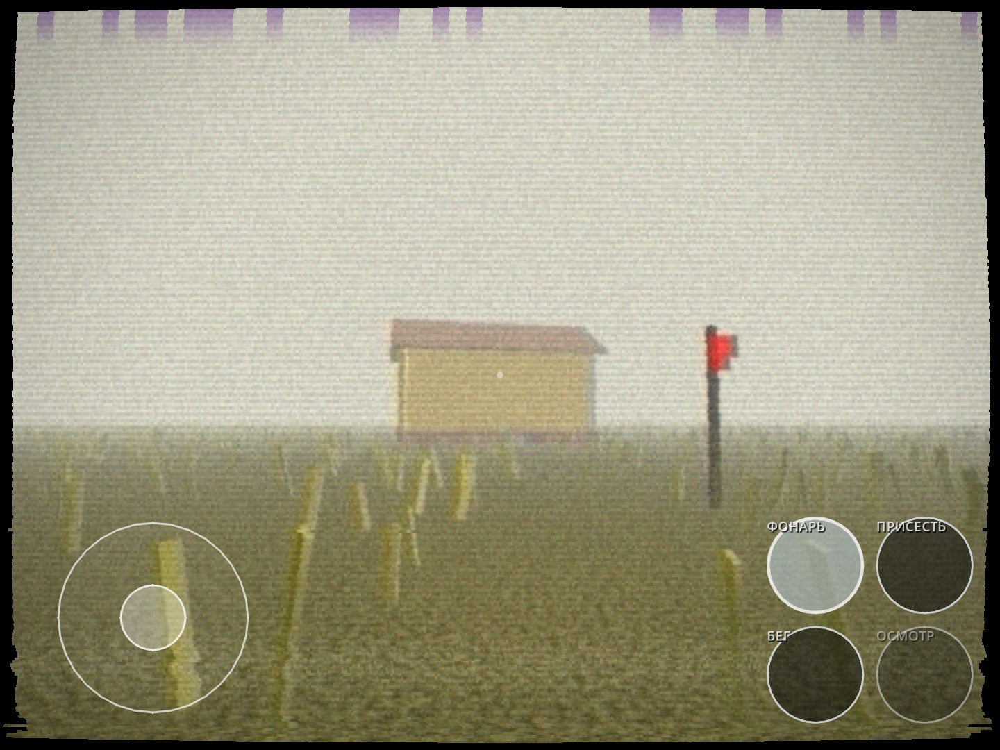
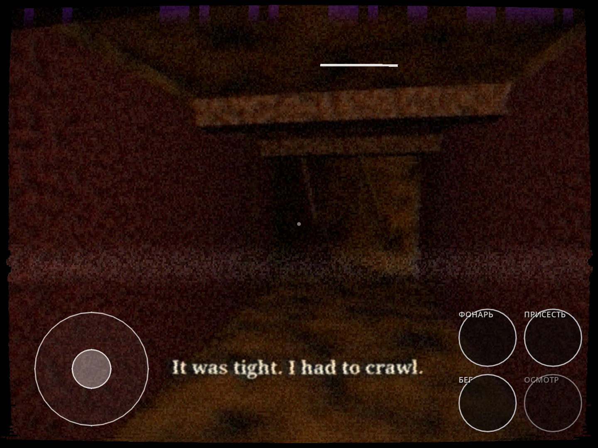
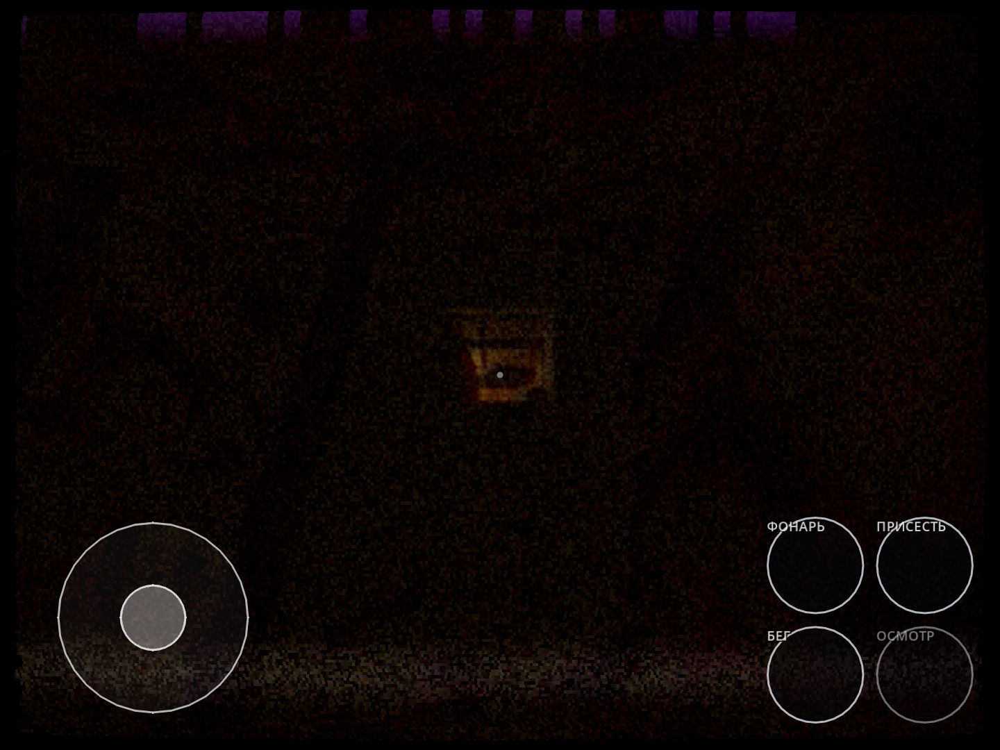
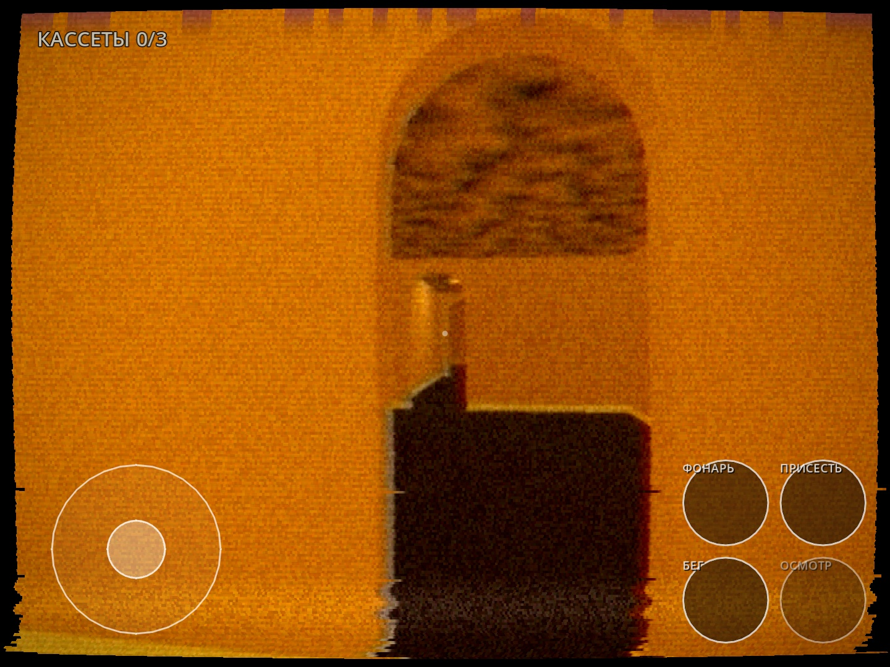
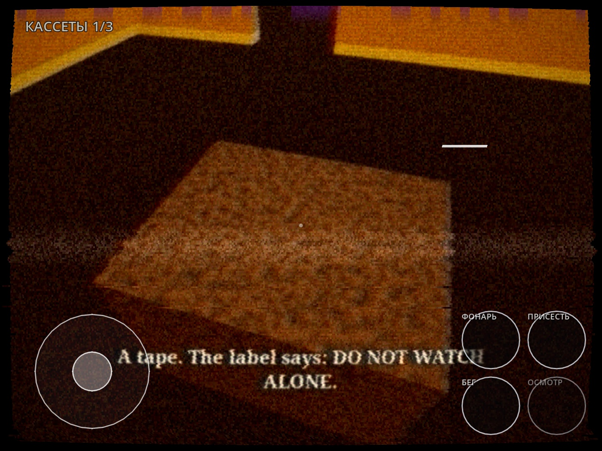
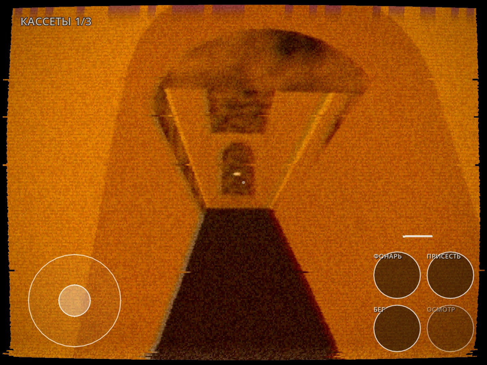

# OBSCURA
## ANALOG HORROR

**A first-person analog horror experience.**

*Three tapes. One impossible house. Something is already inside.*

---

## About the Game

**OBSCURA** is a short first-person horror game inspired by analog horror, found-footage aesthetics, and liminal spaces.

Your journey begins in a quiet field. A lonely house waits in the distance, marked by strange clues. But the way inside is not a normal entrance: you must descend beneath the ground, crawl through a narrow tunnel, and emerge somewhere that feels deeply wrong.

The house is vast, silent, and unsettling. Search its rooms, find the three VHS tapes, and try to understand why you are not alone.

This experience is built around **atmosphere, exploration, and psychological tension** — not constant jump scares.

> *The house has no windows. So how did something see you arrive?*

## Features

- **Analog horror atmosphere** — VHS-inspired image distortion, grain, scanlines, and an aged recording look.
- **Three connected locations** — an open field, a claustrophobic underground tunnel, and a large house.
- **First-person exploration** — search the environment and follow clues to progress.
- **Three collectible VHS tapes** — uncover fragments of the house's story.
- **An unseen presence** — something may briefly appear, watch, and disappear before you can be sure you saw it.
- **Atmospheric audio** — VHS hum, deep horror rumble, footsteps, and crawling sounds.
- **Mobile controls** — virtual joystick, touch camera controls, and on-screen action buttons.

## Screenshots

### 01 — The Field
*Something stands beyond the grass.*

### 02 — The Tunnel
*The way forward is narrow. Keep crawling.*

### 03 — Beneath the House
*You are not supposed to be down here.*

### 04 — The House
*Three tapes are waiting to be found.*

### 05 — The Recordings
*Some things should not be watched alone.*

### 06 — The Corridor
*There is something at the end of it.*

## The Journey

| Chapter | Location | Your Objective |
|:--|:--|:--|
| **I — The Field** | A fog-covered field | Follow the clues and find the house. |
| **II — Below** | An underground passage | Crawl through the winding tunnel and find a way up. |
| **III — The House** | A large, unsettling house | Explore, collect all **three VHS tapes**, and face what comes next. |

**Estimated playtime:** around 10–15 minutes. Your time may vary depending on how much you explore.

## Controls

The game is designed for **landscape mobile play**.

| Control | Action |
|:--|:--|
| Virtual joystick | Move |
| Swipe on the right side | Look around |
| Flashlight | Toggle flashlight |
| Crouch | Crouch / crawl where required |
| Sprint | Run |
| Inspect | Examine / interact with objects |

## Download

The game is distributed as an **Android APK**.

Check the repository's **[Releases](../../releases)** section for the latest available build. If no release is listed yet, the beta APK has not been published there.

> **Beta notice:** This is a beta build. Bugs, performance issues, visual glitches, and gameplay changes are possible.

## Development

- **Engine:** Godot 4.x
- **Project baseline:** Godot 4.3+
- **Language:** GDScript
- **Platform focus:** Android
- **Perspective:** First-person
- **Presentation:** VHS / found-footage / analog horror

## Feedback & Bug Reports

Found something broken, got stuck, or noticed a strange bug?

Please open a [GitHub Issue](../../issues) and include:

- Your device model and Android version.
- The game version you are using.
- What you were doing when the issue happened.
- A screenshot or short video, if possible.

Feedback and bug reports are welcome while the game is in beta.

## Credits

Created with **[Godot Engine](https://godotengine.org/)**.

AI - Generated

OBSCURA is an independent horror project. All trademarks and third-party assets remain the property of their respective owners. This game is inspired by the analog horror video "Obelisk - The House With No Windows" by its original creator - Lizardmeninc. The game has no plans to monetize.

---

### DO NOT TRUST THE SILENCE.

*The recording has not stopped.*

